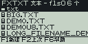
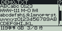
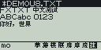

# FXTXT — fx-9750GIII 中文文本查看 / 编辑器

原生 SH-4 附加程序（Add-in，`.g1a`），在 **CASIO fx-9750GIII / fx-9860GIII** 上浏览、
阅读、搜索和编辑存储内存里的 `.txt` 文档。中文用 **FONT8.dlf 小字体**（8×8，括号字形已修），
只有一个字号，把屏幕利用率做到最高。





- **体积**：`out/FXTXT.G1A` = **189 296 字节**（含 GB2312 全字库 + 拼音表）
- **系统**：gint 2.11 / fxSDK 2.11 / GCC 14.1 (`sh3eb-elf`)
- **许可**：MIT（字库另见 [许可](#许可)）

## 功能

| | |
| --- | --- |
| 浏览 | 多级目录、只列文件夹与 `*.txt`、长文件名（63 字节）、`..` 返回上级 |
| 阅读 | 自动折行、`↑↓` 滚一行、`←→` 翻一页、页码显示、无滚动条用满 128 px |
| 搜索 | `F2` 输入关键字，逐条跳转并高亮 |
| 编辑 | 光标移动、`EXE` 换行、`DEL` 删字、`F1` 保存、未保存退出会二次确认 |
| 中文输入 | 内联拼音：底栏显示拼音与候选字，`←→` 选字、`EXE` 上屏 |
| 标点 | `F4` 中文标点页（，。、？！：；“”‘’（）《》……）＋ ASCII 符号页 |
| 文件管理 | `F1` 新建文档、`DEL` 删除文件（带确认页） |
| 记忆 | 退出时记下目录/文件/位置到 `\fls0\FXTXT.CFG`，`F2` 一键回到上次位置 |
| 大文件 | 正文缓冲 32 K → 16 K → 8 K → 4 K 自动降级，实测 10.9 KB / 500 行完整可读 |

## 按键

底栏六个方框就是当前界面的 F 键功能，**空白框表示该位置无功能**。

| 键 | 文件列表 | 阅读 | 编辑 |
| --- | --- | --- | --- |
| `F1` | 新建文档 | — | 保存 |
| `F2` | 回到上次位置 | 查找 | 查找 |
| `F3` | — | 进入编辑 | 退出编辑 |
| `F4` | — | — | 标点符号 |
| `F5` | — | — | 中文 / 英文 |
| `F6` | 帮助 | 帮助 | 帮助 |

其它：

| 键 | 作用 |
| --- | --- |
| `EXE` | 打开 / 进入文件夹 / 换行 / 确认 |
| `EXIT` | 上一级目录 / 关闭 / 离开编辑（有改动时先确认） |
| `MENU` | 随时存盘并回到计算器主菜单 |
| `AC/ON` | 存盘并关机 |
| `DEL` | 列表页删除文件；编辑页删光标前一个字 |
| `SHIFT`+`F3` | 生成示例文档（测试用，不在提示栏） |

## 输入方式（仿计算器原生）

| 操作 | 效果 |
| --- | --- |
| `ALPHA` → 字母键 | 输入该字母，一次性 |
| `SHIFT` → `ALPHA` | **锁定字母模式**，锁标 `A` 立刻出现在标题栏右侧 |
| 字母锁定中按 `ALPHA` | 解除锁定 |
| `F5` | 中文 / 英文输入切换（标题栏显示 `中` / `英`） |
| 数字、`+ − × ÷`、`.` `,` `(` `)` | 直接输入 |
| `ALPHA` + `.` | 空格 |
| `ALPHA` + `×10ˣ` | 双引号 `"` |

字母与实体键的对应（`main.c` 的 `alpha_letter()`）：

| 字母 | 按键 | 字母 | 按键 | 字母 | 按键 |
| --- | --- | --- | --- | --- | --- |
| A–F | `X,θ,T` `log` `ln` `sin` `cos` `tan` | J | `)` | S | `×` |
| G–I | `a b/c` `F⇔D` `(` | K | `,` | T | `÷` |
| M | `7` | L | `→` | U | `1` |
| N | `8` | P | `4` | V | `2` |
| O | `9` | Q | `5` | W | `3` |
| | | R | `6` | X | `+` |
| | | | | Y | `−` |
| | | | | Z | `0` |

### 拼音

中文模式下 `ALPHA` + 字母直接打拼音，**底栏内联显示**，不弹窗：

```
│ no        [摸][牟][某]…            │   ← 拼音缓冲 + 候选字
```

- `←` `→` 选候选字（窗口自动跟随，选中项永远可见），`EXE` 上屏；
- `F2` / `DEL` 删一个拼音字母，`EXIT` 取消本词；
- 多音字按常用读音优先（`行` 在 `hang`、`长` 在 `chang` 下都能找到）。

## 仓库结构

```
.
├─ work/fxtxt/            工程目录（SDK 构建脚本要求这个布局）
│  ├─ CMakeLists.txt
│  ├─ assets/icon.png     30×19 单色图标
│  └─ src/
│     ├─ main.c           全部界面与逻辑（约 3000 行）
│     ├─ font_ascii.c     ASCII 字形 + 比例宽度表
│     ├─ font_cjk8.c      GB2312 字形表（8306 × 8 字节，由 .dlf 生成）
│     ├─ gb_map.c         Unicode ↔ GB2312 映射
│     ├─ gb_rev.c         GB2312 → Unicode
│     └─ pinyin.c         拼音音节表 + 候选字表
├─ tools/
│  ├─ mkfont.py            .dlf → font_ascii.c / font_cjk8.c / gb_*.c
│  ├─ mkpinyin.py          pypinyin → pinyin.c
│  ├─ mkicon.py            任意图片 → 30×19 图标位图（可直写 .g1a）
│  ├─ patchdlf.py          输出修好括号字形的 .dlf
│  ├─ check_pinyin.py      校验 413 个音节能否正确检索
│  ├─ emu_run.py           驱动 FxStudio 模拟器跑一串按键并截图
│  ├─ fontsheet.py         .dlf 字形预览
│  └─ render1bpp.py        1bpp 位图渲染
├─ out/                   发布产物（FXTXT.G1A、修好的字体、截图）
├─ FONT8.dlf / FONT12.dlf 源字库（见「许可」）
└─ icon.png               图标源图
```

## 构建

需要 **fxSDK 2.11 + gint 2.11 + GCC 14.1 (`sh3eb-elf`)**。推荐直接用现成包
（如 FxStudio 自带的离线 SDK）：

```
python <SDK包>\sdk\native\service\build-native.py ^
       <SDK包>\sdk\native  work\fxtxt  work\fxtxt\out  Release
```

产物在 `work\fxtxt\out\artifacts\addin.g1a`，复制成 `out\FXTXT.G1A` 即可。

重新生成字库 / 拼音表：

```
python tools\mkfont.py              # 读根目录 FONT8.dlf / FONT12.dlf
python tools\mkpinyin.py            # 需要 pypinyin：python tools\pipget.py pypinyin
python tools\check_pinyin.py        # 自检
```

## 测试

`tools/emu_run.py` 通过 FxStudio Agent 启动模拟器、按序发送按键并在每步截图：

```
python tools\emu_run.py keys SHIFT,F3,DOWN,EXE,F1
```

截图落在 `work\shots\`。脚本假设 FxStudio 0.2.0 的离线包解在
`ref/pkg3/FxStudio-0.2.0-win-x64/`（`ref/` 不在仓库里，请自行放置）。
模拟器每次启动都是空 flash，所以测试脚本先用 `SHIFT`+`F3` 生成示例文档。

## 已知限制

- **中文文件名**：在部分机器的 OS 版本上 `BFile_FindFirst` 返回 0 条，程序只能靠
  gint 的 `opendir` 列目录，此时非 ASCII 文件名会变成 `_`，无法选中打开。正在解决。
- **USB**：附加程序运行期间插入 USB 线，系统不会弹出连接提示（OS 自己不再轮询）；
  请先按 `MENU` 回主菜单再插线。试过轮询 `usb_is_open()` 与 `INTC_USB` 中断，两者都不反映插线状态。
- 列表最多 64 项；超出部分不显示。
- 无音量/开机画面等无关功能，专注文本。

## 图标规范

主菜单用 **30 × 19** 单色画布（打包时丢第 0、18 行，显示 30 × 17）。右下角建议留一块
纯黑区域——系统会把启动键字母用白色画在那里。

```
python tools\mkicon.py icon.png                  # 任意图片 → 30×19
python tools\mkicon.py --to-bits                 # 导出 #/. 网格
python tools\mkicon.py --from-g1a out\FXTXT.G1A  # 反查校验
```

## 许可

代码以 **MIT** 许可发布，见 [LICENSE](LICENSE)。

`FONT8.dlf` / `FONT12.dlf` 是**第三方像素字库**，不在 MIT 覆盖范围内：只在你拥有相应
授权时再分发。若你要 fork 后公开发布，请换用自己的字库，并用 `tools/mkfont.py` 重新生成字形表。

## 致谢

- [gint](https://gitea.planet-casio.com/Lephenixnoir/gint) 与
  [fxSDK](https://gitea.planet-casio.com/Lephenixnoir/fxsdk)：SH-4 运行时与构建系统
- FxStudio 提供的离线工具链与模拟器
- [pypinyin](https://github.com/mozillazg/python-pinyin)：生成拼音表
